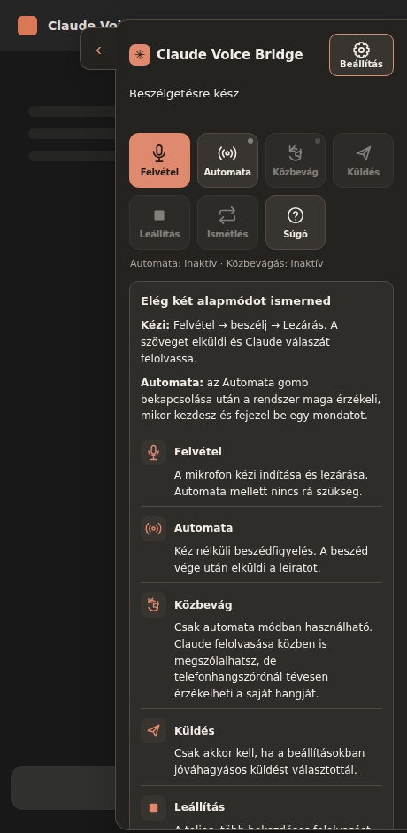
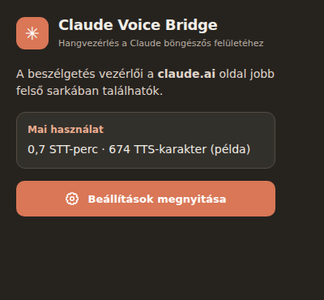

# Claude Voice Bridge

**Magyar hangos beszélgetés a Claude webes felületén, Gemini beszédfelismeréssel és felolvasással.**

A Claude Voice Bridge egy böngészőbővítmény a [claude.ai](https://claude.ai/) használatához. A mikrofonról felvett magyar beszédet a Google Gemini alakítja szöveggé, a bővítmény elküldi a Claude webes felületén, majd a választ magyarul felolvassa. **Nem használ Claude API-t.**



*A v0.5.5 HUD valós HTML/CSS-sablonjából készült előnézet. A súgóban ugyanazok az ikonok láthatók, mint a gombokon. A képek kizárólag mintatartalmat használnak.*



A böngésző eszköztárából megnyitható gyorspanel külön, 360 pixeles, mobilon is alkalmazkodó felületet kapott. A HUD beépített súgója képekkel azonosítja a vezérlőket.

## Mire képes?

- Magyar hangbevitel Gemini 3.5 Transcribe modellel.
- A Claude válaszának felolvasása Gemini 3.8 TTS modellekkel.
- Kézi mikrofonvezérlés vagy bekapcsolható, helyi **Silero VAD** beszédvég-érzékelés.
- Becsukható, a jobb felső sarokban megjelenő Claude-stílusú panel **magyarul feliratozott, kompakt HUD-ikonokkal és lenyitható súgóval**, világos és sötét megjelenéssel.
- **Mobilos érintés-áteresztés:** a HUD láthatatlan külső rétege nem foghatja el a Claude-chat és menük érintéseit. Becsukott állapotban csak a kinyitófül érinthető; nyitva csak a látható panel.
- **Opcionális közbevágás (barge-in):** csak az automata mód melletti külön kapcsolóval aktiválható. Indításkor mindig inaktív. Közbevágásnál először lehalkítja, megerősített beszédre leállítja a felolvasást.
- Két diszkrét hangjelzés a hallgatás és a feldolgozás kezdetéhez.
- **„Leállítás”** gomb: az egész több bekezdéses felolvasást megszakítja, akkor is, ha éppen a Gemini következő hangrészére vár. A közbevágás funkciótól független.
- Halk, négyhangos **„tidintidim”** jelzi a szerverre várakozást: a Gemini **STT** átírásánál 250 ms után és 1,9 másodpercenként, a **TTS**-szövegrészeknél 800 ms után és 3,2 másodpercenként, a **Claude válaszára várva** 1,1 másodperc után és 4,2 másodpercenként. Felolvasás közben és jóváhagyási kérésnél nem szól; a hangjelzések kapcsolójával kikapcsolható.
- A Claude-válasz végét nem állapítja meg pusztán 2,6 másodperc csendből: ha a böngésző nem jelzi megbízhatóan a generálás végét, hosszabb stabilitási időt vár, hogy csökkenjen a hiányos felolvasás esélye.
- Zajküszöb és beszédvégi csend állítása csúszkával.
- A hivatalos Google API-ból lekért modellek és hangok, tájékoztató díjakkal.
- **TTS-próba** a beállításokban: a megadott beszédstílust olvassa fel az éppen kiválasztott hanggal; második koppintásra leáll.
- Napi helyi STT-perc- és TTS-karakterkorlát, automatikus vagy jóváhagyásos üzenetküldés.

## Telepítés

A mindenkori telepíthető ZIP a **[GitHub Releases](https://github.com/sanchomuzax/Claude-voice-bridge-Chrome-extension/releases/latest)** oldalról tölthető le, a *Assets* részben. A ZIP-ben a szükséges ONNX és WASM fájlok is megtalálhatók, így a VAD nem tölt be külső futtatható kódot.

**Android / Quetta:** a Quetta bővítménykezelőjében ZIP-bővítményként töltsd be a csomagot. A Quetta a manuálisan betöltött ZIP helybeni frissítését nem minden verzióban támogatja: előfordulhat, hogy a régi példányt ki kell kapcsolni vagy el kell távolítani. Törlés előtt őrizd meg a saját API-kulcsodat és beállításaidat, mert a helyi tároló törlődhet.

**Asztali Chrome:** csomagold ki a ZIP-et, majd `chrome://extensions` → *Fejlesztői mód* → *Kicsomagolt bővítmény betöltése*. A Chrome androidos kiadása önmagában nem támogatja ezt a telepítési módot.

**Asztali Microsoft Edge:** csomagold ki a ZIP-et, majd `edge://extensions` → *Fejlesztői mód* → *Kicsomagolt betöltése* (*Load unpacked*). A TTS-minta meghallgatása önmagában nem ellenőrzi a mikrofont vagy az STT-t; a Claude-oldali **Felvétel** gomb külön kommunikációs és mikrofonellenőrzést végez.

**Edge / Manifest V3 háttérfolyamat:** a hosszabb Gemini STT- és TTS-műveletek külön `cvb-audio-task` Port-kapcsolaton futnak, 20 másodpercenkénti életjellel. A háttérfolyamat a feldolgozás alatt célzott életben tartást használ, azután felszabadul. Megszakadt kapcsolat esetén a bővítmény látható hibát ad; a korábban elküldött fizetős hangkérést nem indítja újra automatikusan, mert a Google már feldolgozhatta.

**Edge hibakeresés:** a HUD most megkülönbözteti a sikertelen háttérkapcsolatot, a mikrofonengedély vagy hangkódolás hibáját, az üres hangfelvételt, a Gemini STT hibáját és a Claude szövegbeillesztési hibáját. Felvétel indításakor látható a tényleges böngészős hangformátum, a felvétel végén az időtartam és a méret. A háttérkapcsolati hiba **nem** azonos a hibás Gemini API-kulccsal. Egy korábbi böngészőbővítmény-frissítés után aktív oldalon maradt régi content script újratöltést igényelhet. Az automata Silero VAD és a kézi MediaRecorder más hangrögzítési utat használ.

## Automatikus frissítés (v0.5.9+)

A Bridge **óránként ellenőrzi a legutóbbi stabil GitHub Release-t**. Ha van újabb verzió, az eszköztár ikonján `UPD` jelzés jelenhet meg, a felugró panel pedig kiírja a verziókat és a letöltési hivatkozást. A verzióellenőrzés minden olyan böngészőben működik, amely támogatja a szükséges Chromium-bővítmény API-kat. Ha a böngésző nem jelenít meg badge-et, a felugró panel akkor is megmutatja az állapotot.

**Windows / Edge vagy Chrome – opcionális automatikus telepítés:** a bővítmény nem írhatja felül a saját fájljait. Ehhez külön, helyben futó, ellenőrzött Native Messaging segédprogram jár, amely a már beállított kicsomagolt bővítménymappába telepíti a GitHub Release ZIP-jét. Nem `git pull`-t használ: a kiadásban lévő Silero ONNX/WASM állományok is frissülnek. A telepítő a Release mellett publikált SHA-256 ellenőrzőösszeget ellenőrzi, az archívumban tiltja a könyvtárból kilépő útvonalakat és visszaállítja a fájlokat telepítési hiba esetén. Ez a checksum a **GitHub-kiadáshoz tartozó integritásellenőrzés**, nem független kódaláírás.

1. Telepítsd a v0.5.9 vagy újabb ZIP-et **kicsomagolt bővítményként** az `edge://extensions` vagy `chrome://extensions` felületen. A kiválasztott mappát ne mozgasd később; a mappa tartalmazza a `manifest.json` és `native` fájlokat.
2. A bővítménykezelőben másold ki a Bridge **32 karakteres Extension ID** értékét. Nem szükséges `key` mezőt hozzáadnod a manifesthez, amíg ugyanabban a mappában tartod és ugyanabban a böngészőben töltöd be a bővítményt. A Native Messaging engedélyezett eredete ehhez az aktuális ID-hez lesz kötve.
3. Az adott **kicsomagolt mappában** futtasd a PowerShellt (az ID helyére a saját bővítményazonosítód kerüljön):

   ```powershell
   powershell -NoProfile -ExecutionPolicy Bypass -File .\native\install-windows.ps1 -ExtensionId "abcdefghijklmnopabcdefghijklmnop" -Browser Edge
   ```

   A `-Browser Chrome` illetve `-Browser Both` beállítás is használható, de a két böngészőben eltérő Extension ID esetén a konfigurációt külön kell kezelni. A segéd a Python 3 telepített verzióját igényli (`py` vagy `python`). Az aktuális felhasználó profiljába települ, rendszergazdai jogosultság nem szükséges.
4. Nyisd meg a bővítmény felugró paneljét. Az **Ellenőrzés** gombbal azonnal lekérdezheted az új verziót, majd a **Frissítés telepítése** gombbal végrehajthatod. A **Windowsos automatikus telepítés** kapcsoló külön engedélyezhető; alapértelmezetten kikapcsolt.
5. A frissítés után a bővítmény újratöltődik. **A már nyitott claude.ai oldalt kézzel frissítsd**, amikor nem maradt el nem küldött szöveged vagy folyamatban lévő beszélgetésed: az új content script csak így töltődik be.

**Android / Quetta:** a verzióellenőrzés és a kiadás letöltési linkje használható, de a Windowsos Native Messaging segédprogram nem telepíthető. A Quetta ZIP-frissítését továbbra is a böngésző bővítménykezelőjében kell elvégezni. Ne kapcsold be az automatikus telepítést olyan böngészőben, ahol nincs működő native host.

**Biztonsági korlátok:** a segéd csak a konkrét `sanchomuzax/Claude-voice-bridge-Chrome-extension` repó stabil kiadását fogadja el, kizárólag a telepítéskor kijelölt mappába ír, és az extensionből csak egy verziószámot fogad. A program GitHub-kiadáson keresztül érkező futtatható bővítménykódot telepít, ezért csak akkor engedélyezd az automatikus telepítést, ha megbízol a kiadási folyamatban. A natív segédprogram saját kódját a bővítmény nem módosítja; ha a segéd később frissül, a telepítő PowerShell-szkriptet újra kell futtatni.

## Használat

1. A bővítmény beállításaiban add meg a [Google AI Studio](https://aistudio.google.com/apikey) felületén kapott saját Gemini API-kulcsodat.
2. Nyisd meg bejelentkezve a `claude.ai` oldalt, és válassz vagy indíts beszélgetést.
3. Kézi módban koppints a **mikrofonikonra**, majd a rögzítés végén ismét.
4. Kéz nélküli módban kapcsold be a **hullámikonos automata módot**. A felolvasás közben alapból szünetel a mikrofon.
5. Ha nem egyértelmű valamelyik ikon, nyisd meg a **Súgó** gombot. Ha közbe szeretnél vágni, külön kapcsold be a **Közbevág** ikont. A két kapcsoló aktív/inaktív állapotát a megkülönböztetett színek és a panel rövid állapotsora mutatja. Bekapcsolás csak szándékos érintésre történik.
6. Az oldalsó nyíllal a panel becsukható és kinyitható. A zajküszöb és a csendidő közvetlenül a panelen is állítható.

A **Beállítások → Beszédstílus** sor jobb oldalán található lejátszás ikon az aktuális stílus szövegével készít TTS-tesztet. Amíg a gomb aktív, újbóli megnyomással megszakíthatod a próbát. A teszt a Google API-használatba beleszámít.

## Adatvédelem és korlátok

A Gemini API-kulcsot a bővítmény helyben, elkülönített tárolóban kezeli, nem része a forráskódnak. A hangfelvétel és a felolvasásra elküldött szöveg a Google Gemini szolgáltatásához kerül. A Claude beszélgetése a bejelentkezett webes munkamenetben történik. Érzékeny adatokkal a prototípust ne használd.

**Fontos a közbevágásról:** a Silero VAD nem tudja garantáltan megkülönböztetni a telefon hangszórójából visszahallatszó beszédet a te hangodtól. A bővítmény akusztikus visszhangszűrést (AEC) és rövid megerősítő figyelést használ, de hangszóróval téves megszakítás lehetséges. Fülhallgatóval várható a jobb eredmény. Az új mód Quettán még eszköztesztelésre vár.

A bővítmény nem hivatalos Anthropic- vagy Google-termék. A Claude felületének változása megszakíthatja a működését. Az Android/Quetta automatikus VAD és a háttérben működés nem minden készüléken igazolt, vezetés közbeni használatra nem hitelesített. A helyi keretek **nem garantált számlázási limitek**.

## Fejlesztőknek

Node.js 20+, `npm install`, `npm run check`, `npm run build`, `npm run pack`. A GitHub Actions minden módosításnál teszteli és csomagolja a bővítményt, a kiadásokat pedig a **Releases** menüpont kezeli. Az előző kiadások változáslistáját a megfelelő Release leírásában találod.

Felhasznált technológiák: [Silero VAD](https://github.com/snakers4/silero-vad), [@ricky0123/vad-web](https://github.com/ricky0123/vad), [ONNX Runtime Web](https://onnxruntime.ai/) és [Google Gemini API](https://ai.google.dev/gemini-api/docs).

Licenc: [MIT](LICENSE). A külső összetevők saját licenceit a [harmadik féltől származó összetevők](THIRD_PARTY_NOTICES.md) dokumentum tartalmazza.
