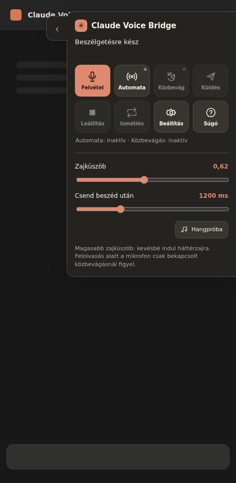

# Claude Voice Bridge

**Magyar hangos beszélgetés a Claude webes felületén, Gemini beszédfelismeréssel és felolvasással.**

A Claude Voice Bridge egy böngészőbővítmény a [claude.ai](https://claude.ai/) használatához. A mikrofonról felvett magyar beszédet a Google Gemini alakítja szöveggé, a bővítmény elküldi a Claude webes felületén, majd a választ magyarul felolvassa. **Nem használ Claude API-t.**

*A v0.5.1 HUD forrásából készített, mintatartalmat használó előnézet. Nem tartalmaz valódi beszélgetést vagy API-kulcsot.*

## Mire képes?

- Magyar hangbevitel Gemini 3.5 Transcribe modellel.
- A Claude válaszának felolvasása Gemini 3.8 TTS modellekkel.
- Kézi mikrofonvezérlés vagy bekapcsolható, helyi **Silero VAD** beszédvég-érzékelés.
- Becsukható, a jobb felső sarokban megjelenő Claude-stílusú panel **magyarul feliratozott, kompakt HUD-ikonokkal és lenyitható súgóval**, világos és sötét megjelenéssel.
- **Opcionális közbevágás (barge-in):** csak az automata mód melletti külön kapcsolóval aktiválható. Indításkor mindig inaktív. Közbevágásnál először lehalkítja, megerősített beszédre leállítja a felolvasást.
- Két diszkrét hangjelzés a hallgatás és a feldolgozás kezdetéhez.
- **„Leállítás”** gomb: az egész több bekezdéses felolvasást megszakítja, akkor is, ha éppen a Gemini következő hangrészére vár. A közbevágás funkciótól független.
- A Gemini **beszédátírása (STT)** és a következő szövegrész **hanggenerálása (TTS)** alatt ugyanaz a halk, négyhangos **„tidintidim”** jelzés szól. 0,8 másodperc várakozás után indul, majd körülbelül 3,2 másodpercenként ismétlődik. A szerver válaszának megérkezésekor vagy hiba esetén leáll. A meglévő hangjelzések-kapcsolóval kikapcsolható.
- Zajküszöb és beszédvégi csend állítása csúszkával.
- A hivatalos Google API-ból lekért modellek és hangok, tájékoztató díjakkal.
- **TTS-próba** a beállításokban: a megadott beszédstílust olvassa fel az éppen kiválasztott hanggal; második koppintásra leáll.
- Napi helyi STT-perc- és TTS-karakterkorlát, automatikus vagy jóváhagyásos üzenetküldés.

## Telepítés

A mindenkori telepíthető ZIP a **[GitHub Releases](https://github.com/sanchomuzax/Claude-voice-bridge-Chrome-extension/releases/latest)** oldalról tölthető le, a *Assets* részben. A ZIP-ben a szükséges ONNX és WASM fájlok is megtalálhatók, így a VAD nem tölt be külső futtatható kódot.

**Android / Quetta:** a Quetta bővítménykezelőjében ZIP-bővítményként töltsd be a csomagot. A Quetta a manuálisan betöltött ZIP helybeni frissítését nem minden verzióban támogatja: előfordulhat, hogy a régi példányt ki kell kapcsolni vagy el kell távolítani. Törlés előtt őrizd meg a saját API-kulcsodat és beállításaidat, mert a helyi tároló törlődhet.

**Asztali Chrome:** csomagold ki a ZIP-et, majd `chrome://extensions` → *Fejlesztői mód* → *Kicsomagolt bővítmény betöltése*. A Chrome androidos kiadása önmagában nem támogatja ezt a telepítési módot.

## Használat

1. A bővítmény beállításaiban add meg a [Google AI Studio](https://aistudio.google.com/apikey) felületén kapott saját Gemini API-kulcsodat.
2. Nyisd meg bejelentkezve a `claude.ai` oldalt, és válassz vagy indíts beszélgetést.
3. Kézi módban koppints a **mikrofonikonra**, majd a rögzítés végén ismét.
4. Kéz nélküli módban kapcsold be a **hullámikonos automata módot**. A felolvasás közben alapból szünetel a mikrofon.
5. Ha nem egyértelmű valamelyik ikon, nyisd meg a **Súgó** gombot. Ha közbe szeretnél vágni, külön kapcsold be a **Közbevág** ikont. A két kapcsoló aktív/inaktív állapotát a megkülönböztetett színek és a panel rövid állapotsora mutatja. Bekapcsolás csak szándékos érintésre történik.
6. Az oldalsó nyíllal a panel becsukható és kinyitható. A zajküszöb és a csendidő közvetlenül a panelen is állítható.

A **Beállítások → Beszédstílus** sor jobb oldalán található lejátszás ikon az aktuális stílus szövegével készít TTS-tesztet. Amíg a gomb aktív, újbóli megnyomással megszakíthatod a próbát. A teszt a Google API-használatba beleszámít.

## Adatvédelem és korlátok

A Gemini API-kulcsot a bővítmény helyben, elkülönített tárolóban kezeli, nem része a forráskódnak. A hangfelvétel és a felolvasásra elküldött szöveg a Google Gemini szolgáltatásához kerül. A Claude beszélgetése a bejelentkezett webes munkamenetben történik. Érzékeny adatokkal a prototípust ne használd.

**Fontos a közbevágásról:** a Silero VAD nem tudja garantáltan megkülönböztetni a telefon hangszórójából visszahallatszó beszédet a te hangodtól. A bővítmény akusztikus visszhangszűrést (AEC) és rövid megerősítő figyelést használ, de hangszóróval téves megszakítás lehetséges. Fülhallgatóval várható a jobb eredmény. Az új mód Quettán még eszköztesztelésre vár.

A bővítmény nem hivatalos Anthropic- vagy Google-termék. A Claude felületének változása megszakíthatja a működését. Az Android/Quetta automatikus VAD és a háttérben működés nem minden készüléken igazolt, vezetés közbeni használatra nem hitelesített. A helyi keretek **nem garantált számlázási limitek**.

## Fejlesztőknek

Node.js 20+, `npm install`, `npm run check`, `npm run build`, `npm run pack`. A GitHub Actions minden módosításnál teszteli és csomagolja a bővítményt, a kiadásokat pedig a **Releases** menüpont kezeli. Az előző kiadások változáslistáját a megfelelő Release leírásában találod.

Felhasznált technológiák: [Silero VAD](https://github.com/snakers4/silero-vad), [@ricky0123/vad-web](https://github.com/ricky0123/vad), [ONNX Runtime Web](https://onnxruntime.ai/) és [Google Gemini API](https://ai.google.dev/gemini-api/docs).

Licenc: [MIT](LICENSE). A külső összetevők saját licenceit a [harmadik féltől származó összetevők](THIRD_PARTY_NOTICES.md) dokumentum tartalmazza.
